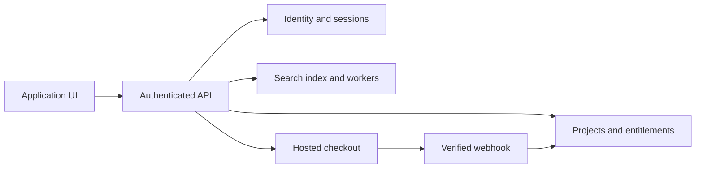

# Research Question Explorer / 研究问题探索

**状态 / Status：架构建议。** 当前已发布的 Atlas 提供本地图谱筛选、文献导航与定期更新。本次改动没有创建账户、服务器搜索、注册接口或收款配置。The published Atlas currently provides browser-local graph filtering, literature navigation and scheduled snapshots. The following is a proposed service architecture.

## 部署选择 / Hosting decision

公开研究图谱可以继续使用 GitHub Pages。未来登录搜索原型技术上可调用独立 API；若主要功能成为会员付费搜索，应将应用前端和后端迁到允许商业应用的平台，Pages保留公开研究图谱或文档。GitHub Pages官方限制主要用于商业交易或商业SaaS的站点，并要求避免敏感交易。[GitHub Pages limits](https://docs.github.com/en/pages/getting-started-with-github-pages/github-pages-limits)

The public research atlas can stay on Pages. A paid research-search application should use hosting that supports commercial applications, with the application UI and API under a coherent service domain. A managed/serverless backend can provide this; purchasing a traditional server is optional.

## 拟议组件 / Proposed components

| 组件 / Component | 职责 / Responsibility |
|---|---|
| 公开 Atlas / Public atlas | 图谱、文献阅读、资源链接 / Maps, reading and references |
| 应用前端 / Application UI | 问题输入、结果、引用和个人项目 / Questions, results, citations and projects |
| 认证与 API / Authenticated API | 会话、每次请求的权限与额度 / Sessions, per-request authorization and quotas |
| 检索与任务 / Search and workers | 文献索引、版本去重、排序与证据标记 / Indexing, version groups, ranking and provenance |
| 数据库 / Database | 账户、保存的搜索、项目权限与权益 / Accounts, saved searches, project access and entitlements |
| 托管付款页 / Hosted checkout | 付款交互；服务端核验事件后更新权益 / Checkout and server-confirmed entitlements |

## 服务端责任 / Trusted-server responsibilities

1. 每次搜索、导出及受保护文件读取都核验身份、项目归属和套餐权益。浏览器隐藏控件只影响呈现。Authorize each protected operation on the server, including project ownership and entitlements. [OWASP Authorization](https://cheatsheetseries.owasp.org/cheatsheets/Authorization_Cheat_Sheet.html)
2. 优先采用成熟认证服务及后端会话，使用 HTTPS、Secure/HttpOnly/SameSite cookie、CSRF防护、退出失效与限速。前端localStorage仅适合当前语言偏好等低风险设置。Use a mature identity/session system and server-managed session controls. [OWASP Sessions](https://cheatsheetseries.owasp.org/cheatsheets/Session_Management_Cheat_Sheet.html)
3. 由服务端确定可信价格、创建托管结账，验证webhook签名并处理重复及乱序事件，再更新权益。成功跳转页面只承担用户反馈。Create checkout sessions and grant entitlements through verified, idempotent server-side fulfillment. [Stripe fulfillment](https://docs.stripe.com/checkout/fulfillment), [webhooks](https://docs.stripe.com/webhooks)
4. 心理研究问题可能包含敏感资料，设计中应最小化查询记录，定义同意、保留、删除、项目隔离及脱敏审计。公开站点数据包只包含可公开资源。Minimize sensitive-query logging and define retention, deletion and access boundaries. [OWASP Logging](https://cheatsheetseries.owasp.org/cheatsheets/Logging_Cheat_Sheet.html#data-to-exclude)

## 下一阶段的输入 / Inputs for a later implementation

明确检索语料与版权、目标用户、账户方案、免费/付费额度、数据区域和预算后，再选托管平台与实现搜索API。Then define acceptance tests for account isolation, search relevance/citations, quotas, session expiry, billing events and deletion. The public atlas and a protected service should have separately documented audiences and data flows.
